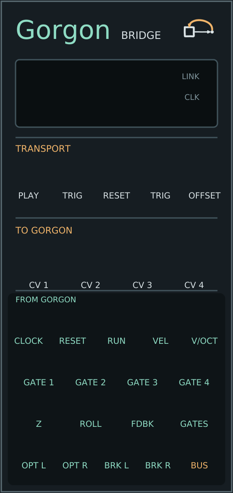

# Gorgon

A CV and audio/video tracker, in development. One score with up to 128 pattern
slots and six note lanes, plus visual automation, drives a picture, a modular
synthesizer and VCV Rack from a single playhead. Gorgon is the master clock;
nothing follows an external one.

The tracker runs inside [HydraPy](https://github.com/JosiahAlanLee/hydrapy)
Studio. Use it to enter musical phrases, automate a patch's visual controls,
switch between named scenes, and send Program and Auxiliary pictures to
separate displays. Its browser synth lets you audition a score; hardware CV
and VCV Rack can play that same score through other instruments.

[Start](#start) · [Tracker interface](#tracker-interface) · [VCV Rack](#vcv-rack) ·
[Full tracker guide](https://github.com/JosiahAlanLee/hydrapy/blob/main/docs/gorgon-tracker.md)

## Start

On Linux, the session launcher can open Studio's tracker and picture window,
then Rack with your saved patch and JACK/PipeWire routing:

```sh
gorgon start
```

Install it once with `python -m pip install -e .` in your HydraPy environment.
Use `gorgon init` to select your existing rig, and `gorgon doctor` to check it.
The [launcher guide](docs/LAUNCHER.md) covers setup, audio-device selection and
session controls. The launcher lives here; sequencing/rendering still live in HydraPy.

From a HydraPy checkout, install the GPU/video extras and open the tracker:

```sh
python -m pip install -e ".[gpu,video]"
hydrapy studio patches/gorgon_corridor.py --tracker
```

Open Studio's printed local URL in your browser. **Space** starts or pauses;
**F** enters fullscreen. Turn on **Sound** to audition the browser synth.
The included corridor patch gives the visual automation lanes immediate
effects: Dolly Z changes its 2D scale, Roll rotates it, and Feedback controls
recursive image memory. The [tracker guide](https://github.com/JosiahAlanLee/hydrapy/blob/main/docs/gorgon-tracker.md)
also gives a smaller CPU setup.

## Tracker interface

A score in **format 3** (`hydrapy-tracker-3`) has **six note lanes** and
**128 pattern slots** in eight banks, A–H, of sixteen. A **chain** of 1–256
pattern codes plays them in song order and may repeat a pattern, or ↻ loops the
one you are editing. Each pattern has a **rate** (¼× to 8×), **bar** (1–32 rows
per bar) and **bars** (1–8), with their product at most 128 rows. Each lane has
its own **length** (1 through the pattern's row count) and repeats within the
pattern. Notes can carry a
**condition** (`1:4`, `%50`, `F` for FILL, `1ST`) and lanes take **transforms**
(`rot`, `rev`, `ply`, `degrade`, `every`). A note can also set an explicit
**length** of 0.25–16 base rows (480 ticks each), independent of pattern rate;
it is clipped at the pattern entry boundary. The evaluator places onsets and
query boundaries on integer ticks, 1920 per quarter note, while an explicit
duration may be fractional; signals and automation read the real-valued beat.

The versioned [score-v3 contract](spec/score-v3.md) is authoritative; the
[specification index](spec/README.md) lists the related evaluator, transform
and bus-I/O contracts.

Versions 1 and 2 are still supported: **four fixed 64-row patterns** and four
note lanes. A score stays in its format while the edits fit it. The first edit
that needs version 3 (a fifth or sixth lane, a pattern past A04, or a rate, bar,
bars, lane-length, chain, condition or transform edit) upgrades it, and undo
restores the old format. Launching, looping or seeking into a pattern past A04
upgrades it without an undo step. Row numbers are hexadecimal:
`00`–`3F` means rows 0–63. The green playback row and amber edit cursor are
separate: clicking a cell selects where to edit; it does not move playback.

| Area | What you use it for |
| --- | --- |
| **Arrangement cards** | Select the pattern to edit (in format 3, from banks A–H; the chain sets their song order); each card shows note activity and explicit automation keys. Its **▶** button launches that pattern. Pattern tools rename, copy or clear it. |
| **Transport** | Set tempo and key, play/pause, Stop, Loop and Follow. **Seek to row** moves playback to the edit cursor. Follow tracks the playing pattern; manual editing turns it off. Selecting another card while looping edits that pattern without switching the active loop. |
| **Note lanes** | Six lanes in format 3; versions 1 and 2 populate only lanes 1–4. Each shows the score's own lane name (`Lane 1`–`Lane 6` until you rename it), not the voice that auditions it. Each occupied cell has a note and velocity, and in format 3 may have a condition, sound locks and an explicit length. The lanes supply gates, held pitches and velocities to CV/Rack instruments. |
| **Dolly Z / Roll / Feedback** | Three automation lanes, bound to the loaded patch's named controls under **Patch bindings**. Values use their lane units: 0–1, −45° to +45°, and 0–0.9. |
| **SCENE** | Choose a scene declared by the patch and a fade length in rows. The scene holds until the next change. Try [gorgon_scenes.py](https://github.com/JosiahAlanLee/hydrapy/blob/main/patches/gorgon_scenes.py) for a patch with named scenes. |
| **Selected-cell editor and curve** | Enter an exact note/velocity, automation value, or scene/fade. The automation curve writes at the edit cursor; **Hold**, **Linear** and **Smooth** choose how that lane moves between keys. |
| **Instruments / Sound** | Browser synth demo and audition controls. FM hits and Sub play pitched notes. The Sound toggle controls this audition path; CV and Rack follow the score independently. |
| **Program / Auxiliary** | Open separate output windows and route `o0`–`o3` to each under **Output routing**. Move them to other monitors and press F there. **BLACK OUT** blanks the browser monitors; recordings and exports keep their picture. |
| **File / Save session** | Save or restore the score, import JSON, download a recovery copy, or open **Patch editor & export** for the patch code, recording and export tools. |

### Enter a first phrase

1. Pause, select a pattern card, then click an **FM hits** or **Sub** cell.
   Enter `C4` in **Note** and a velocity such as `100`; `C-4` is the same note
   in tracker notation. Leave the key at D minor to hear notes as entered.
   **AIR** is an unpitched hit that keeps the held pitch; velocity zero is silent.
2. Enable **Piano keys**, choose an octave and row advance, then type notes
   into the grid: Z/X/C/V enter C/D/E/F; S enters C♯. With Piano keys off,
   **Enter** toggles a hit. **? Help** shows the complete keyboard map.
3. Select a block with Shift+click, drag, or Shift+arrows. Copy/Paste repeats
   it, transpose moves the notes, and block velocity changes existing hits.
   Undo/Redo also covers pattern operations and score imports.
4. Select an automation cell, enter a value, and choose Hold, Linear or
   Smooth. For example, set Dolly Z to `0.25` on row `00` and `0.75` on row
   `20`, then choose Linear. Bind it to the patch control you want to move.
5. Use **Seek to row**, then Space to play, or launch with a card's **▶**.
   Open Program on another display, then **Save session** to write the workspace
   score and download its JSON. After restarting Studio, use **Restore saved
   score** or **Import score** to load it again.

With Piano keys enabled, B enters a note in an audio lane; use the visible
BLACK OUT button while entering notes. Seeking moves the musical playhead
while keeping the renderer's simulation time and feedback history.

The [editor walkthrough](https://github.com/JosiahAlanLee/hydrapy/blob/main/docs/gorgon-editor-walkthrough.md)
covers keyboard entry, blocks, pattern tools, bindings, displays and recovery
in detail. The [tracker guide](https://github.com/JosiahAlanLee/hydrapy/blob/main/docs/gorgon-tracker.md)
covers scenes, patch lane signals, timing, CV and exports. Visual automation
is included in supported video exports; browser synth audition audio is not.

## The pieces

This repository holds the **contract**, **VCV Rack module**, **tutorial kit**
and **integration tests**. The tracker editor, renderer and direct CV outputs
live in HydraPy.

| Piece | Where | What it does |
| --- | --- | --- |
| Tracker and visuals | [hydrapy](https://github.com/JosiahAlanLee/hydrapy) — `hydrapy studio --tracker` | The score editor, the playhead, automation of a patch's controls, named scenes chosen per row, Program and Auxiliary outputs |
| Direct CV | hydrapy — `--cv-device`, `--cv-profile` | Clock, reset, run, gates, 1 V/oct pitch, velocity and automation as control voltage: a DC-coupled interface such as an Expert Sleepers ES-3, or an ES-40 with ESX-8GT/ESX-8CV expanders over encoded S/PDIF; PortAudio or native JACK/PipeWire |
| Rack module | [`rack/`](rack) here — plugin `GorgonBridge` | Follows Studio's playhead on Rack's sample clock and puts the score on jacks; CV patched in goes back to the patch's controls and transport; captures Studio's audio ports |
| Audio | hydrapy — Output routing | An optical soundtrack read from the picture and a synthesized breaks kit, as JACK/PipeWire ports |
| Contract | [`spec/`](spec) here | The score format, the bridge API, the signal semantics and the audio ports, with a conformance fixture |

For hardware CV, add `--cv-device "<interface>" --cv-map 8`, or a profile for
ES-40 expanders ([ES-40 setup](https://github.com/JosiahAlanLee/hydrapy/blob/main/docs/es40.md)).

## VCV Rack



The coordinated preview is being prepared; this repository has no published
release yet. The [preview release guide](docs/PREVIEW_RELEASE.md) describes the
six-plugin bundles, exact source pins and remaining release blockers. Until it
is published, build [`rack/`](rack) against the Rack SDK.

1. Install the `GorgonBridge` plugin from this repository's
   [releases](https://github.com/JosiahAlanLee/Gorgon/releases) or build
   [`rack/`](rack) against the Rack SDK, then add **Gorgon** to a patch. It
   finds Studio by itself ([manual](rack/docs/MANUAL.md)).
2. Patch its clock, gates, polyphonic V/OCT and velocities to your instruments.
   The channels are the tracker's note lanes: six for a format-3 score
   ([GATE 1–6](rack/docs/MANUAL.md#version-3-scores)), four for versions 1 and 2.
   CV 1–4 can drive free named patch controls back in Studio. **BUS OUT** can
   send the lanes' hits and FILL as a byte bus, and **BUS IN** mutes lanes and
   turns on FILL from one ([manual](rack/docs/MANUAL.md#bus-in),
   [bus-io.md](spec/bus-io.md)).
3. For audio into Rack, enable the JACK/PipeWire ports in Studio's Output routing
   and select them as Gorgon's capture device
   ([audio guide](https://github.com/JosiahAlanLee/hydrapy/blob/main/docs/gorgon-audio.md)).

The plugin also has **Ping**, a latency meter: it times a destination from its
trigger to its sound and stores the result with the patch
([manual](rack/docs/MANUAL.md#ping-measuring-latency)).

Tested Gorgon, HydraPy, DSP_Emulation and Generative_Art combinations, their
validation levels, and the evidence for each are recorded in
[tested combinations](docs/tested-combinations.md).

## Status

Everything above exists and is tested in CI: HydraPy's suite (including
Chromium, and real JACK and PipeWire daemons), and here the Rack module's
engine against HydraPy's own outputs, the bridge against a real Studio,
sanitizers, Rack's API, and Windows/macOS builds.

The same Linux checks also pass on the workstation (2026-10-25: Ubuntu 22.04,
Rack SDK 2.6.6, HydraPy at the pin). The fixture is byte-identical, the follower
stays within 0.05 ms of a real Studio, and the schema check accepts all 202 scores.
The whole chain also runs in VCV Rack Free 2.6.6 on private JACK1 and PipeWire 1.0.7
servers at 48 kHz/256. Studio drives Gorgon and Gorgon plays a Vastish voice on every
gate. The clock holds 138 BPM to within 0.01 ms. The four captured channels match
Studio's ports sample for sample, to within float rounding, arriving 10.7 ms later
(16 ms in one JACK run).
An earlier headless run in Rack Pro showed only that the plugin loads: that copy of
Rack Pro was not signed in to a VCV account, and an unsigned Rack Pro processed no
audio in a later test.

What is **not** validated: physical interfaces on the workstation, the desktop's
own PipeWire session, a signed-in Rack Pro, the ES-40 digital path end to end,
display and device latency, and the Windows/macOS plugins inside Rack. The plugin
is not in the VCV Library yet.

## Tutorial

[`tutorial/`](tutorial) is the kit for recording the ecosystem tutorial on one
machine: a private stage (display, JACK, Studio, Rack), a script of shots, and the
tools that film, narrate, edit and check them. It is not part of the plugin.

## Working on it

The [drum-machine design assessment](docs/DRUM_MACHINE.md) maps a Machinedrum-like
workflow onto Gorgon, original Rack percussion, Otis-derived sampling and a
shared event/pattern layer. It distinguishes the first independent synthesis
prototype from the sequencer and sampling work still needed.

Read [AGENTS.md](AGENTS.md) first: where a change goes, how the contract
changes, how the HydraPy pin moves. Short version: the contract in `spec/`
changes first, then HydraPy, then `rack/`.

## Lineage

The Rack module was developed in
[DSP_Emulation](https://github.com/JosiahAlanLee/DSP_Emulation) as `vcv/gorgon`
and moved here with its history on 2026-10-25. DSP_Emulation remains the home of
OTIS, Vastish and Spoon Bender, the instruments Gorgon's gates and pitch were
built to drive.

## License

BSD-3-Clause ([LICENSE](LICENSE)) for everything here, the Rack module included.
HydraPy is AGPL-3.0-or-later, following Hydra.
