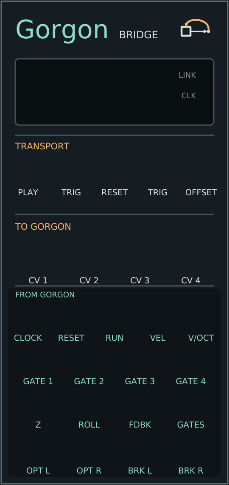

# Gorgon manual

Gorgon connects VCV Rack to the Gorgon tracker in [HydraPy](https://github.com/JosiahAlanLee/hydrapy) Studio. Gorgon is the master clock: Rack follows its tempo, position and score, and CV patched into the module goes back into the visuals.

## Setup

1. Start Studio on the same computer: `hydrapy studio patches/gorgon_corridor.py --tracker`. On start Studio writes its port and session token to `~/.hydrapy/studio.json`, readable only by you, and removes it on exit.
2. Add Gorgon to a Rack patch. The display shows **Linked** and the tempo once it finds Studio, usually within a second. If Studio restarts, Gorgon finds it again.

The score/CV bridge discovers Studio automatically. To point it at a different file, set `HYDRAPY_STUDIO_FILE` before starting Rack. Studio only listens on 127.0.0.1, so Rack and Studio must run on the same machine. Audio capture has a separate setup below.

## Outputs: from Gorgon

| Jack | Signal |
|---|---|
| CLOCK | 10 V pulses, 50% duty. Sixteenths by default; *Clock* in the context menu sets 1, 2, 4, 8 or 24 per quarter note |
| RESET | 5 ms trigger on start, resume or seek, and at the score/pattern loop boundary. Transport pulses are latched even when an update arrives late |
| RUN | 10 V while Gorgon plays |
| VEL | Polyphonic, 4 channels: each audio lane's last hit velocity, 0–10 V, held until the next hit |
| V/OCT | Polyphonic, 4 channels: held note pitch, 1 V/oct. C4 = 0 V by default; *Pitch zero* in the context menu also offers C3 = 0 V |
| GATE 1–4 | 10 V for half a row on each hit in that audio lane; muted lanes stay low. *Gate length* sets 25–100% of a row |
| GATES | The four gates as one polyphonic cable |
| Z | Dolly Z lane, 0–1 as 0–10 V |
| ROLL | Roll lane, ±45° as ±5 V |
| FDBK | Feedback lane, 0–0.9 as 0–10 V |
| OPT L / OPT R | Optical Soundtrack audio from capture channels 1/2, PCM −1…1 as −10…10 V |
| BRK L / BRK R | Synthesized Breaks kit from capture channels 3/4, PCM −1…1 as −10…10 V |

When Gorgon is paused or its automation is off, clock, reset, run and gates stop. The lanes hold their current value.

The pitch channels line up with VEL and GATES: use a polyphonic voice, or split the
four channels for separate voices. Notes use C0–G9 (sharps allowed); `C-4` means
C4. The key selector transposes by the chosen key minus D, matching the browser
and direct CV. AIR opens a gate and updates velocity while keeping the previous
pitch. Velocity zero opens no gate and preserves both held values. Muting a lane
also keeps its held values. Start/resume/seek clear held values before the next hit.

**CV output levels** in the context menu selects 10 V (existing Rack default)
or 5 V (matching Studio's direct CV). It scales clock, reset, run, gates, held
velocity, Z and feedback together. Pitch remains 1 V/oct, roll remains ±5 V,
and the audio jacks retain their separate scaling. The setting is saved with
the Rack patch. Existing port IDs are preserved; the four audio outputs are
appended after V/OCT.

## JACK / PipeWire audio

1. Install HydraPy's `jack` extra, start the audio server, and enable **JACK /
   PipeWire audio** under the tracker's **Output routing**.
2. Right-click Gorgon and select the JACK audio driver, capture device and
   input channel group exposing four channels. With PipeWire, run both Studio
   and Rack through `pw-jack` when required by the distribution.
3. In the patchbay, connect Studio's displayed `optical_L`, `optical_R`,
   `breaks_L`, `breaks_R` ports to Rack's corresponding capture channels 1–4.
   Connect the module's four audio jacks to a mixer/processor and an ordinary
   Rack Audio output module. Gorgon itself only captures audio.

Optical reads the patch's first two Soundtracks (one is duplicated, none is
silent). Breaks is the first tracker's synthesized kick/snare/hat kit, not
recorded break samples. Browser Sound remains an independent audition path.
Studio's software buffer lead adds latency; **OFFSET** changes the score/CV
timing, not received PCM. Audio conversion follows Rack's engine sample rate.
The bounded queue drops excess backlog rather than growing latency indefinitely;
disconnect/underrun produces silence. Counters are in the context menu.

Keep any ES-40 encoded S/PDIF route separate from this listening-audio path;
never resample/mix/gain it through these jacks. Its polarity compensation lives
in Studio's Output routing, per digital pair. See HydraPy's
[audio guide](https://github.com/JosiahAlanLee/hydrapy/blob/main/docs/gorgon-audio.md)
and [ES-40 guide](https://github.com/JosiahAlanLee/hydrapy/blob/main/docs/es40.md).

## Inputs: to Gorgon

**CV 1–4** set the patch's named controls. 0–10 V spans the control's range: for a control from −2 to 2, 5 V gives 0. A control follows its CV only while a cable is patched.

By default each input takes the next control not already driven by a tracker lane, in the order the patch declares them. Choose a specific control, or none, under *CV n drives* in the context menu. Choices are saved with the Rack patch and use control names, so they survive editing the HydraPy patch.

A control bound to a tracker lane in Studio is driven by the score while automation is on, and CV for it is ignored until automation is off.

## Transport

- **PLAY** (button or trigger) starts Gorgon if it is stopped, and pauses it if it is playing.
- **RESET** (button or trigger) moves Gorgon to the start of the score, or of the looped pattern.

Both act on Studio, so the picture and every other Gorgon output move too.

## Timing

Studio's playhead reaches the module about 30 times a second. Between updates the module runs its own beat at the score's tempo on Rack's sample clock, and trims that tempo by at most 0.5% to stay aligned with Studio. Clock pulses, gates and held automation steps therefore land on exact samples and stay evenly spaced. Seeks, tempo changes, starting and stopping are followed as soon as the next update arrives, within about 35 ms.

The end-to-end test (`tests/studio_e2e.py`) reports follower phase error against a running Studio and requires less than 1 ms in that harness. It does not measure physical audio or display latency.

Transport changes carry a separate revision from score edits. The module emits
a complete reset pulse on receiving a seek, even when the playhead is already
past its first 5 ms. Editing a note, changing a control or receiving another
cached snapshot does not retrigger reset. The browser, direct CV and bridge use
the same pre-render timestamp, so rendering time is not added to one follower's
clock estimate. This does not compensate physical display or device latency.

**OFFSET** (±100 ms) moves Rack's outputs earlier (clockwise) or later than the picture, to make up for audio and video latency. To set it, patch GATE 1 into a percussive voice, give lane 1 a hit on every beat, and turn OFFSET until each hit lines up with a visible flash in Gorgon.

## Display and lights

The display shows the link state and tempo, then the pattern, row and beat, then what each CV input drives. **LINK** is lit while Studio answers. **CLK** follows the clock output. PLAY's light is lit while Gorgon plays.

If Studio stops answering, the module keeps the last tempo and position and carries on until Studio is back.
